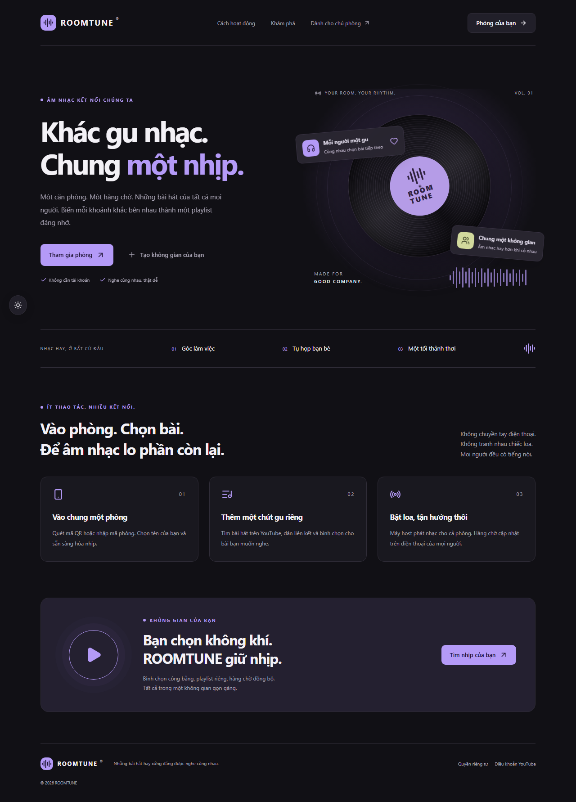

# ROOMTUNE — Chung một nhịp

Ứng dụng nghe YouTube chung nhiều phòng. Điện thoại tìm bài, yêu cầu và bình chọn; máy host mở trình phát YouTube thật và nối loa. Giao diện tiếng Việt, dark/light, React SPA + Hono trên Cloudflare Workers, dữ liệu PostgreSQL/Supabase.

**Trạng thái:** đã kiểm chứng local/Supabase hosted và người dùng xác nhận nghe được âm thanh. Bản chia sẻ thử qua tunnel tại https://roomtune.dzoanh.me đã kiểm tra HTTPS/API, phát nhạc, gia hạn phiên và biểu quyết qua desktop/mobile. Xem [chạy tunnel](docs/TUNNEL.md), [kiểm tra public](docs/PUBLIC_CHECK.md) và [kiểm thử](docs/TESTING.md). Chưa deploy Cloudflare Workers production. Không có dữ liệu giả ở runtime.

Lượt tính năng biểu quyết đạt **135 unit/API/React tests, 35 database checks, 62 room/session E2E tests** (2 ca layout mobile skip vì đã quét ở project desktop), strict TypeScript và lint. PostgreSQL tests gồm 30 thao tác đồng thời và backup/restore thật. Lighthouse landing mobile ở lượt đo trước trên bản production local đạt **100 Performance / 100 Accessibility**; xem [report HTML](docs/lighthouse-local.report.html). Điểm local không đại diện cho các màn hình cần dịch vụ thật.

Để bật biểu quyết đổi thứ tự: chủ phòng vào **Cài đặt phòng → Hàng chờ & bình chọn → Biểu quyết khi đổi vị trí bài → Lưu cài đặt**. Thành viên chọn **Đề xuất vị trí** cạnh bài hát. Cần quá nửa người online lúc tạo đề xuất và tối thiểu 2 phiếu đồng ý; một người không thể tự duyệt. Tắt tùy chọn để owner/moderator sắp xếp trực tiếp. Bài đang phát tiếp tục trong lúc biểu quyết.

**Cờ cá ngựa:** phát hành cùng phòng nhạc. Trong phòng, chọn **Trò chơi → Tạo bàn mới**.
Game có trang riêng, hỗ trợ 2–4 người, xúc xắc CSS 3D và hiệu ứng đi quân; chuyển qua lại vẫn giữ máy phát nhạc.
Xem [cách chơi](docs/GAME.md) và [kiểm thử bản public](docs/GAME_PUBLIC_CHECK.md).

**Gợi ý nhạc (đã public):** vào **Tìm & thêm bài**, để trống ô tìm kiếm để xem
**Nghe lại cùng phòng** và **Khám phá nhạc mới**. Kết hợp lịch sử của phòng với nhạc phổ biến
trên YouTube; có nút thêm bài, đổi gợi ý và tìm nhanh theo thể loại/kênh.
Khám phá hiện 12 bài ban đầu, có **Xem thêm** và bộ lọc **Việt Nam / Mỹ / Hàn Quốc / Nhật Bản**.
Tổng hợp loại trùng giữa các nguồn, tăng kho bài quen lên tối đa 24 bài và khám phá tối đa 120 bài;
số lượng thực tế phụ thuộc nguồn nhạc và giới hạn của phòng.
Xem [cách dùng và giới hạn](docs/RECOMMENDATIONS.md), [kiểm tra public qua HTTPS](docs/RECOMMENDATIONS_PUBLIC_CHECK.md).
Đã phát hành tại https://roomtune.dzoanh.me ngày 16/11/2026.

**Danh sách online/offline (đã public):** trong phòng, bấm nút **N online** ở
thanh đầu để xem thành viên. Có tìm tên, lọc online/offline, vai trò và dấu **Bạn**;
mất kết nối hiển thị trạng thái chưa xác định. Xem [hướng dẫn](docs/MEMBERS.md).

**Tìm kiếm:** tự tìm sau khi ngừng gõ 650 ms, không cần Enter. Đã bỏ hai trần tìm kiếm
riêng của ứng dụng và sửa lọc video theo quốc gia VN; quota YouTube và chống spam chung
vẫn áp dụng. Xem [giới hạn hiện tại](docs/SEARCH_LIMITS.md).

## Chạy local

Yêu cầu Node >=22.12, pnpm 11.25.0.

```powershell
pnpm install
Copy-Item .env.example .env
Copy-Item .dev.vars.example .dev.vars
# Điền các giá trị theo docs/DEPLOYMENT.md
pnpm dev
```

Mở http://localhost:5173. Khi chưa có cấu hình, landing, theme, join/login forms và trang lỗi chạy; API bảo vệ từ chối truy cập. Không có chế độ fake backend trong production.

```powershell
pnpm lint
pnpm format:check
pnpm typecheck
pnpm test
pnpm test:db
pnpm build
pnpm check:secrets
pnpm exec playwright install chromium
pnpm test:e2e
pnpm test:e2e:room
```

`test:db` khởi chạy PostgreSQL 17 riêng biệt trên port 55439, áp dụng migration thật; chỉ các schema Supabase Auth/Realtime được fixture. Không trỏ script này vào production. PostgreSQL tạm được dừng trong finally; thư mục tạm được giữ để chẩn đoán.

## Tài liệu

- [Cờ cá ngựa — cách chơi và bản thử local](docs/GAME.md), [bằng chứng kiểm thử game](docs/GAME_TESTING.md).
  `npm.cmd run game:start` mở bản thử tại `http://127.0.0.1:5180`; `game:stop` chỉ tắt bản thử.
  Dùng `npm.cmd run build:game` khi cập nhật bản riêng; giữ nguyên `dist` và tunnel public.

- [Kế hoạch](docs/PLAN.md), [kiến trúc](docs/ARCHITECTURE.md), [database](docs/DATABASE.md), [API](docs/API.md)
- [Hướng dẫn thành viên](docs/USER_GUIDE.md), [quản trị](docs/ADMIN_GUIDE.md)
- [Triển khai](docs/DEPLOYMENT.md), [vận hành và backup](docs/OPERATIONS.md)
- [Bảo mật](docs/SECURITY.md), [xử lý sự cố](docs/TROUBLESHOOTING.md)

Phát hành qua tunnel trên máy theo yêu cầu người dùng; mã nguồn tại [DzoanhDoanh/music-box](https://github.com/DzoanhDoanh/music-box). Chưa deploy Workers production hoặc bật dịch vụ trả phí. Người dùng tạo Supabase project/tài khoản chủ phòng và cung cấp cấu hình; cấu hình bí mật, runtime và backup không nằm trong Git. PMP được người dùng miễn cho dự án MusicBox.

Nếu PowerShell chưa có `pnpm` nhưng dependencies đã cài, dùng `npm.cmd run dev` để chạy local. Supabase CLI có sẵn tại `.\node_modules\.bin\supabase.cmd`. `node scripts/check-services.mjs` kiểm tra kết nối mà không in key; `node scripts/provision-admin.mjs email@example.com` cấp quyền cho tài khoản đã xác nhận. Kiểm thử hosted là thao tác chủ động tạo/dọn dữ liệu thử, chạy bằng `node scripts/test-hosted.mjs --project-ref MA_PROJECT` trên môi trường được phép.


